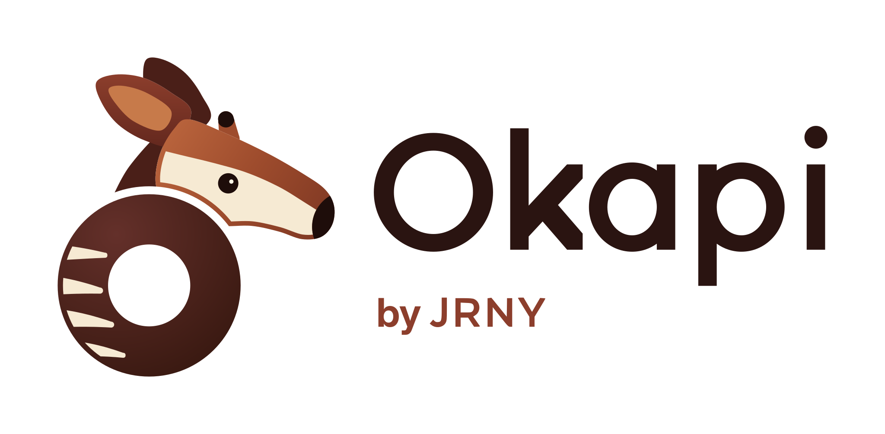

  <picture>
    <source media="(prefers-color-scheme: dark)" srcset="brand/okapi-peek/lockup-horizontal-dark.svg">
    
  </picture>

# Okapi

A browser by JRNY.

Okapi is an Android browser with separate Profiles, so you can stay signed in to a different account on the same site in each one. For example, work Google in one Profile and personal Google in another.

> **Status:** early development. You can create, switch, edit and delete Profiles, each with its own Tabs and its own sign-ins. Tabs come back after Android kills the app (Private Tabs do not). Each Profile keeps its own history, bookmarks and downloads, and can open Private Tabs. Settings choose the search engine, suggestions, Safe Browsing and the theme. A Tab can be moved to another Profile or opened in one. Links from other apps open in the Active Profile, or in the Profile a Site Rule names for their site. This project is built in public. See the [roadmap](docs/ROADMAP.md).

## What it will do

- **Profiles**, each with its own cookies, site data, tabs, history, bookmarks and downloads.
- **Move a tab to another Profile** to open the same page signed in as a different account.
- **Links from other apps** open in the Profile you were last using, or, with a Site Rule, always in the Profile you chose for that site.
- **Pinned tabs and folders**: each Profile's bookmarks sit at the top of its tab list, open or closed, and closing one keeps it.
- **Tablet layout** with an Arc-style sidebar of tabs and the Profile switcher at the bottom.
- **Phone layout** with a Safari-style bottom bar for search and switching Profiles.
- **Extensions** from addons.mozilla.org, with uBlock Origin installed by default to block ads and trackers.
- **No telemetry**: no analytics and no crash reporting, in the app or in its engine. No Google Play Services, no trackers.

Requires Android 15 or later.

## Repository layout

This is a monorepo with two projects:

| Folder | What it is |
| --- | --- |
| [`android/`](android/) | The Android app: a Gradle project (Kotlin, Jetpack Compose). Run `./gradlew` from this folder. |
| [`website/`](website/) | The product website: static files that GitHub Pages publishes. See [website/README.md](website/README.md) to preview and publish it. |

The documents below, the [changelog](CHANGELOG.md) and the CI workflow sit at the root and cover both.

## Documentation

- [SPEC.md](docs/SPEC.md): what v1 does
- [ROADMAP.md](docs/ROADMAP.md): milestones
- [GLOSSARY.md](GLOSSARY.md): the project's vocabulary
- [docs/adr](docs/adr/): architecture decisions and why we made them
- [Brand](brand/README.md): the Okapi logo, which drawing to use where, and minimum sizes

## Contributing

Read [CONTRIBUTING.md](CONTRIBUTING.md). To report a security problem, follow [SECURITY.md](SECURITY.md). Never open a public issue for one.

## License

[MIT](LICENSE). The APK also carries [uBlock Origin](https://github.com/gorhill/uBlock)'s signed release file, unchanged, under its own license, GPL-3.0.
